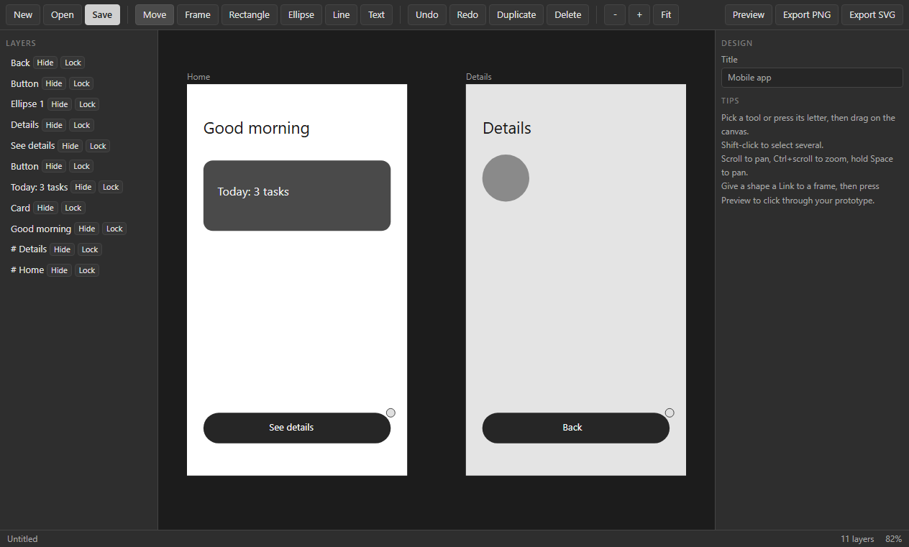

# Frameout

A focused, private design tool for Windows. Lay out screens on an infinite canvas, link them together and click through your prototype, with no account, no subscription and no internet connection.

## What you can do

- **Frames, rectangles, ellipses, lines and text** drawn directly on the canvas
- **Layers panel** to select, hide, lock and reorder
- **Properties**: position, size, fill, stroke, corner radius, opacity, font size
- **Align** several layers, nudge with the arrow keys, duplicate, copy and paste
- **Prototype links**: connect a button to another frame, then press **Preview** to click through the flow full screen
- Infinite canvas with pan, zoom and fit, undo and redo
- **Export** a frame or the whole design as PNG or SVG, or save a Frameout file to continue later

## Your files stay on your computer

Frameout has no account, no cloud and no tracking. Files are opened and saved only through the dialogs you use, and nothing is uploaded.

## Download

Get **Frameout-Setup-1.0.0.exe** from the [Releases](../../releases/latest) page and run it.

Part of the [Lookout](https://github.com/plawanpawin-byte/Lookout) family of apps.

Released under the MIT License.
