

<h1 align="center">Frameout</h1>

<b>Screen design and prototypes</b> Version 1.0.13 for Windows · Free · Offline · No account

<a href="https://github.com/plawanpawin-byte/frameout/releases/latest"><b>Download Frameout</b></a> · <a href="https://github.com/plawanpawin-byte/lookout-launcher">Lookout launcher</a> · <a href="https://github.com/plawanpawin-byte/Lookout">All Lookout apps</a>

---

Frameout is a canvas for designing app screens and web pages. Draw a frame for each screen, fill it with rectangles, circles, lines and text, rearrange layers, then export a screen as an image or an SVG. Link a shape to another frame and click through your design in Preview.

**Made for:** Designers, developers and founders who need a quick, private place to sketch interfaces.

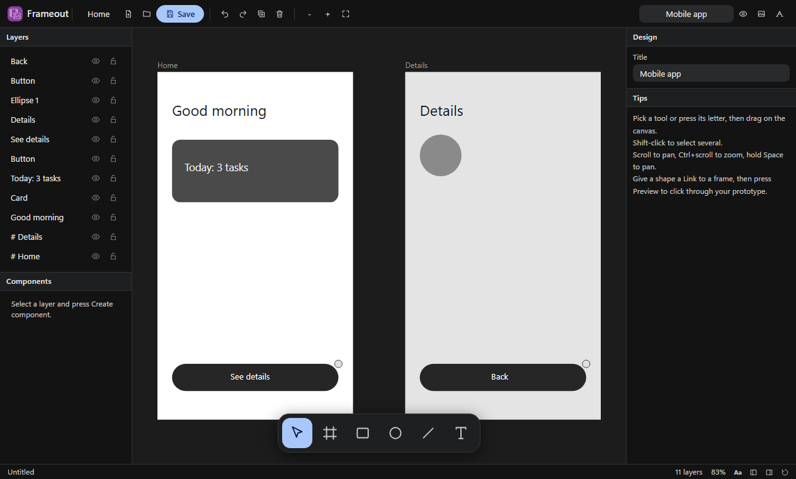

**On this page:** [In plain words](#in-plain-words) · [Who it is for](#who-it-is-for) · [Home screen](#the-home-screen) · [Try it in 3 steps](#try-it-in-3-steps) · [Screenshots](#see-it-in-action) · [Features](#everything-it-can-do) · [How to use it](#how-to-use-it) · [Privacy](#private-by-design) · [Install](#install) · [Questions](#questions)

## In plain words

Frameout is a design tool for sketching **app screens and web pages** before anyone builds them. Each screen is a **frame** (a rectangle shaped like a phone, tablet or page). Inside a frame you draw rectangles, circles, lines and text, and arrange them in layers, so you can mock up a login screen or a shop page in minutes.

Then comes the part that makes it a prototype: you can **link a shape to another frame**. Press Preview and click the button in your design to jump to the next screen, exactly as a real app would. You can export any screen as an image or SVG to show a client or a developer.

**Not for:** Frameout is for layout sketches and click-through demos. It does not generate code and is not a photo editor.

## Who it is for

- **Designers and founders** who want to show an idea before it is built.
- **Developers** who need a quick layout sketch.
- **Students** doing interface-design assignments.

## The home screen

Frameout opens on a home screen. **Recent** shows the designs you worked on, each with a small picture of its first screen, its name and when you last edited it. Click one to carry on. Your work is kept automatically on this computer, so you do not have to save a file to find it again. Use **Remove** on a card to take it off the list.

A bar on the left switches between three tabs. **Home** has Start and Recent. **Templates** has ready layouts to start from: mobile app, login screen, landing page, dashboard, Instagram quote and a 16:9 slide. **Settings** lets you choose whether Frameout opens on Home or on your last design, how many recent designs to keep (6, 12 or 24), and clear the Recent list.

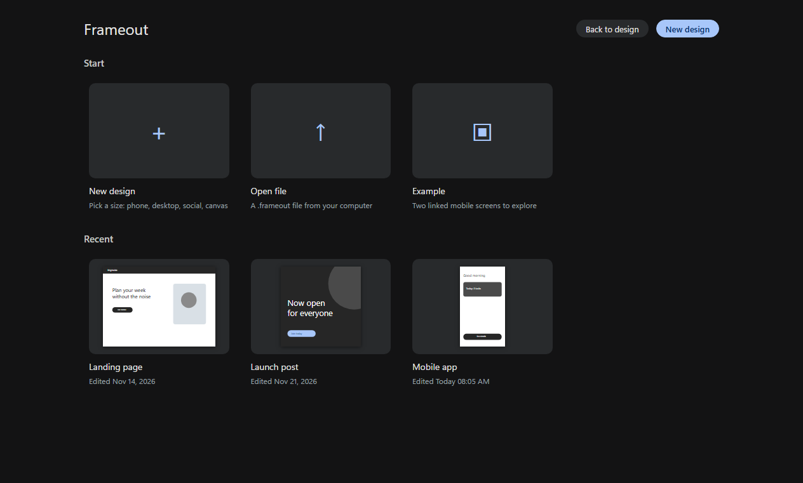

Choose **New design** and you go straight to an empty canvas, zoomed out so there is room all around. There is no question to answer first: name it in the box at the top right, then draw a frame (F). Select a frame and pick a size in the right panel (phone, tablet, desktop, Instagram, YouTube and more). For a ready-made start, use the **Templates** tab.

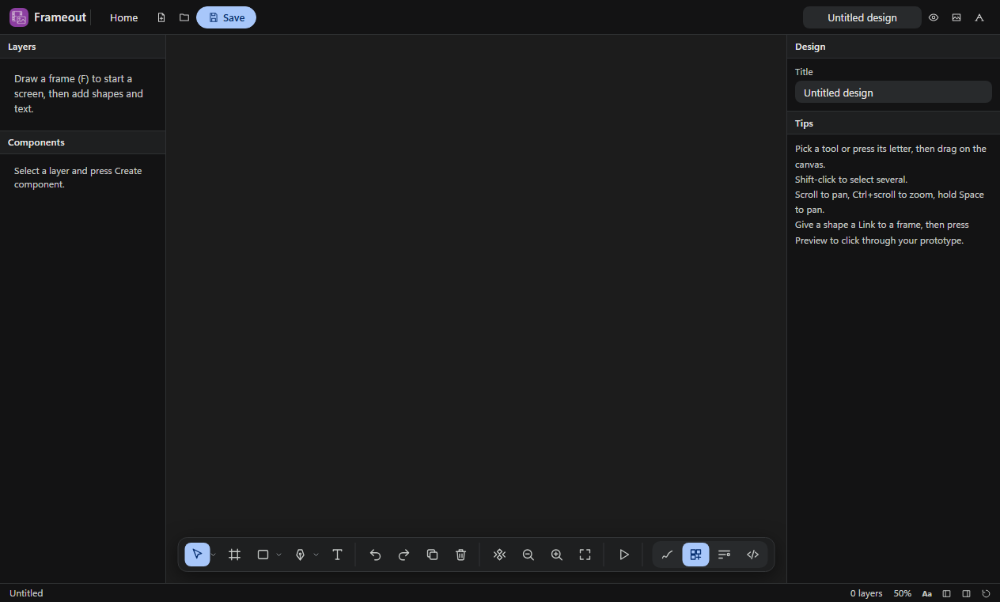

### Templates and Settings

The **Templates** tab shows every ready layout with a small picture. **Settings** has the options for opening, how many recent designs to keep, and clearing Recent.

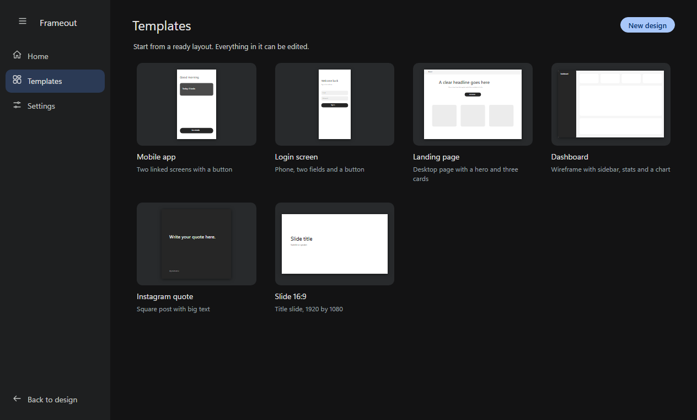

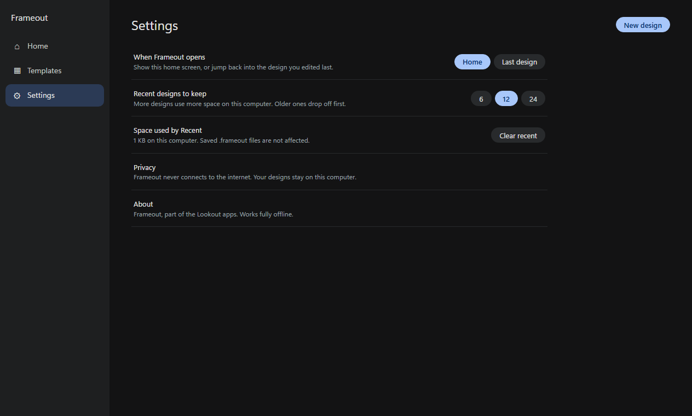

### Folders and your own templates

Under **Folders** in the left bar, press **+** to choose a folder on your computer (the folder window lets you make a new one). The folder appears in the bar. Open it to see the designs inside, press **New design here** to start one that saves straight into that folder, or **Add files** to bring in `.frameout` files you already have. **Save** keeps writing to the same file. Removing a folder only removes it from the list; your files stay where they are.

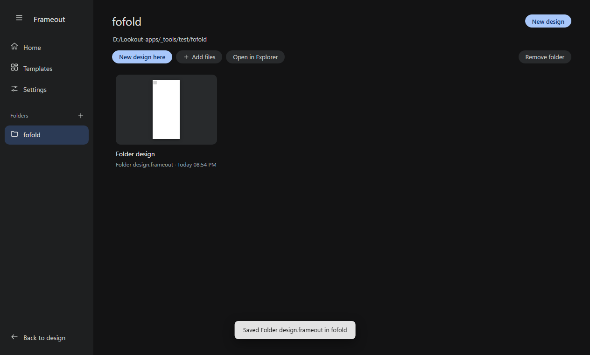

In **Templates**, **My templates** lets you upload your own `.frameout` project. It becomes a template you can start new designs from (a copy is kept inside Frameout, your original is not touched).

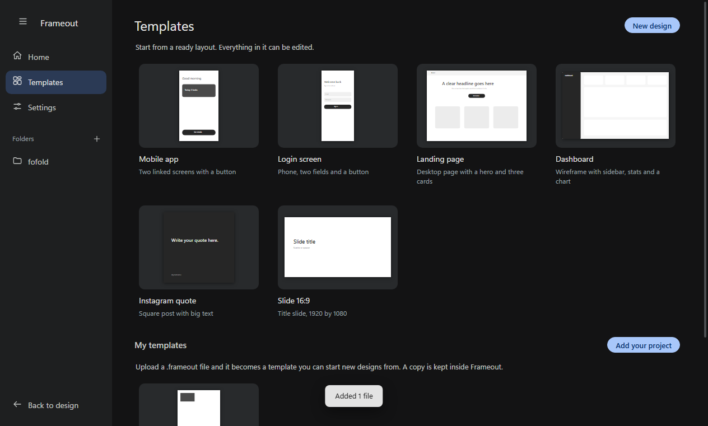

### Tool menus and the four modes

Like Figma, tools that belong together share one button. The small arrow next to **Move** opens Hand; next to the shapes button it opens Rectangle, Line, Arrow, Ellipse, Polygon, Star and Image; next to the pen it opens Pen and Pencil. The button shows the last one you picked.

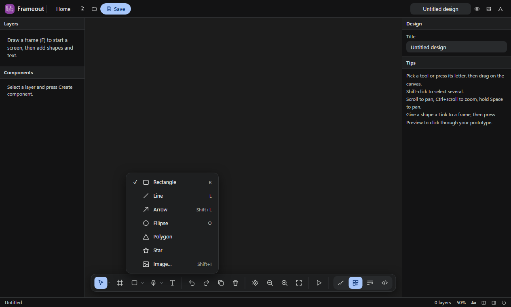

At the right end of the bar are four mode buttons:

- **Draw** keeps only drawing tools. **Pen**: click to add corners, click the first point (or press Enter, or click the last point again) to finish; clicking the first point closes the shape. **Pencil**: drag to draw freehand. Shapes stay editable vectors: move, resize, change colour, make a path closed or smooth.

  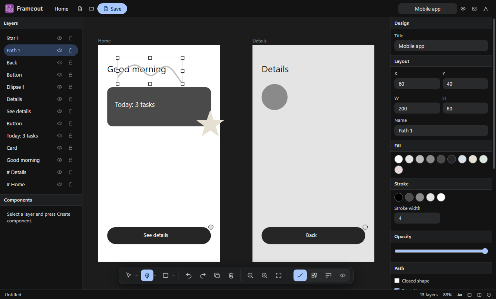

- **Design** is the normal editor (frames, components, auto layout, prototype preview).
- **Motion** adds a timeline. Select a layer, put the playhead on a time and press **Add keyframe**; move the playhead, change the layer's position, size, rotation or opacity, and add another. Choose easing (linear, ease in, ease out, ease in-out), set the duration, drag the playhead to scrub, and press **Play** (with optional **Loop**). Animations are saved in the file. Layers rest at their time-0 position when you leave Motion mode or save.

  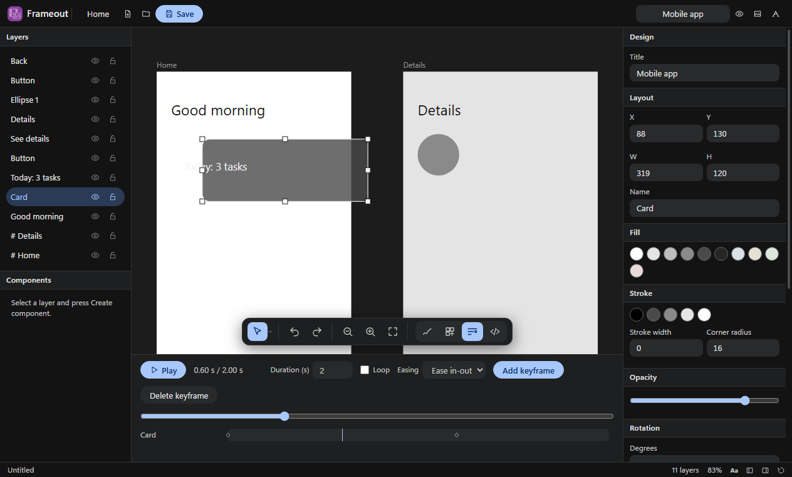

- **Dev** is read-only inspection: click a layer to see its size, position and distances to its frame (also drawn on the canvas), copy ready-made CSS or the layer's SVG, export PNG or SVG, write a note for developers and tick **Ready for dev** (a green dot appears on the layer). The panel also lists every colour used.

  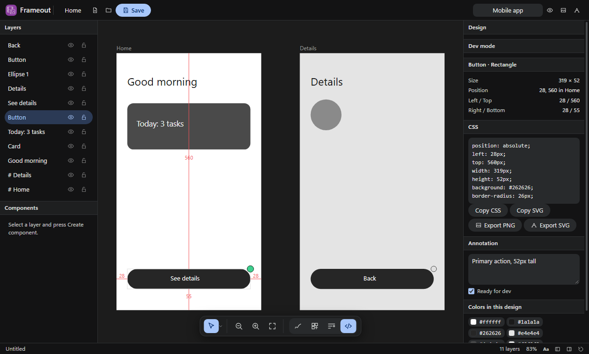

Not in these modes yet: curved (Bézier) pen handles, brushes, boolean shape operations, automatic keyframes, exporting an animation as a video or GIF, version comparison and developer integrations.

### Pictures, rotation, gradients, shadows and text styles

- **Images:** press the picture button in the bottom bar (or Shift+I) and choose PNG, JPG, WebP or GIF files. They are shrunk to keep the design small and stored inside the `.frameout` file. Pictures can have rounded corners, a shadow and rotation like any other layer.
- **Rotation:** type degrees in the Rotation box in the right panel.
- **Gradient:** tick *Fade to a second color*, pick the second color and an angle (90 is top to bottom).
- **Shadow:** tick *Drop shadow* and set X, Y, blur and strength.
- **Text:** choose a font (sans-serif, serif or monospace), Bold, and Left, Center or Right alignment. After you place a text layer you can type at once; double-click a text layer to edit it.

Gradients, shadows, rotation and pictures all appear in PNG and SVG exports. Frames cannot be rotated, and a rotated layer can be moved but not resized with the handles (set its width and height in the panel instead).

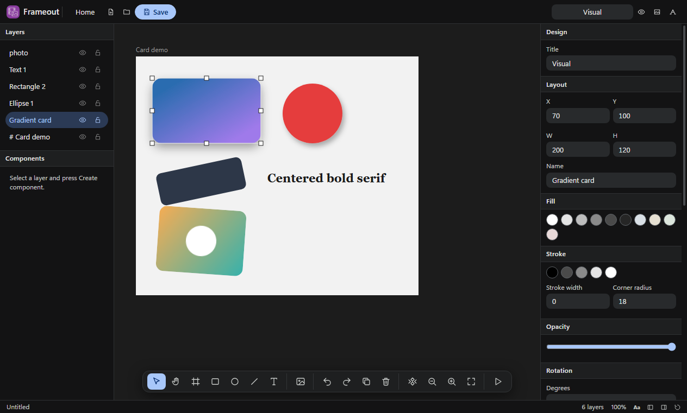

Press **Home** in the top bar at any time to come back to this screen. Your design is saved to Recent first.

## Try it in 3 steps

1. Press **New design**, draw a frame (F), then a rectangle and some text inside it.
2. Add a second frame and link a button in the first frame to it.
3. Press **Preview** and click through your screens, then export one as an image.

## What is new

**1.0.26:** New design opens an empty, zoomed-out canvas with no size question (sizes are now a preset list in the frame's panel). Tools are grouped in dropdown menus like Figma, with new Arrow, Polygon, Star, Pen and Pencil tools, and four modes at the end of the bar: Draw, Design, Motion (keyframe timeline) and Dev (inspect, CSS, annotations).

**1.0.25:** pictures, rotation, gradients, drop shadows and text styles (font, bold, alignment).

**1.0.24:** folders on your computer in the left bar, and your own projects as templates.

**1.0.23:** after you place a text layer you can type straight away, and double-click a text layer to edit it, instead of hunting for the Text box in the right panel.

**1.0.22:** the bottom bar is smaller and holds more: a Hand tool (H) to pan, Undo, Redo, Duplicate, Delete, Create component, Zoom out, Zoom in, Fit and Preview, next to the drawing tools.

**1.0.21:** the tool bar at the bottom is wider and lower, so it covers less of your design.

**1.0.20:** the drawing tools (Move, Frame, Rectangle, Ellipse, Line, Text) now sit in a floating bar at the bottom of the canvas, like Figma, with larger icons. Shortcuts V, F, R, O, L and T still work.

**1.0.19:** you can name a design: a Name box in the New design window, and a name box at the top right of the editor to rename it any time. The name shows on its Recent card and is used as the file name when you save or export.

**1.0.18:** cleaner line icons in the left bar and on the Start cards, and the New design window now also lists the templates.

**1.0.17:** the left bar can be closed to icons only (the ☰ button) and opens again the same way; Frameout remembers your choice.

**1.0.16:** the home screen has a tab bar on the left: Home, Templates and Settings.

**1.0.15:** a home screen with your recent designs and a size picker for new ones (phone, tablet, PC, Instagram and more). Duplicate, copy and delete now take everything inside a frame with them, and a copied screen is placed beside the original. Auto layout works with frames inside frames.

**1.0.13:** A new look inspired by Google's own tools (AI Studio, Colab, Gemini): a calm dark charcoal theme, rounded pill buttons, a soft blue accent and roomier spacing. The app icon is now a colour logo so you can find Frameout at a glance in the Start menu and in the Lookout launcher. All screenshots below were taken again with the new look. The program now shows under its own name (not Electron) in Task Manager and the taskbar.

## See it in action

### Two screens on the canvas

Frames for a home screen and a detail screen, built from rectangles, circles and text. The layers list on the left names every object.

### Layer properties

Select a layer to change its position, size, corner radius, fill, outline, opacity and text.

### Selecting several layers

Shift + click to select more than one layer and move or style them together.

### Exported home screen

Select a frame and export it as a crisp PNG.

### Exported detail screen

Each frame exports on its own, so one file can hold a whole app.

## The interface

- **Top bar:** file buttons, the drawing tools (Move, Frame, Rectangle, Ellipse, Line, Text), undo, redo, duplicate, delete, zoom, Preview and Export PNG / SVG.
- **Left panel:** every layer by name, with show/hide and lock buttons.
- **Right panel:** position, size, name, fill, stroke, corner radius, opacity, prototype link and arrange controls of the selection.

## Everything it can do

### Drawing

- Frame, rectangle, ellipse, line and text tools
- Corner radius, fill, outline width and opacity
- Font size for text

### Layers

- A layer list with names, with hide and lock for each layer
- Frames hold the objects placed inside them

### Prototype

- Give a shape a link to a frame
- Preview mode lets you click through your screens like a real app

### Canvas

- Infinite canvas with pan, zoom and Fit
- Duplicate, delete, undo and redo

### Files and export

- Save and reopen .frameout files
- Export the selected frame as PNG
- Export SVG for developers

## How to use it

1. Pick **Frame** and drag out a screen.
2. Choose **Rectangle**, **Ellipse**, **Line** or **Text** and draw inside it.
3. Select a layer to change its colours and size on the right.
4. Give a button a link to another frame, then press **Preview**.
5. Select a frame and press **Export PNG** or **Export SVG**.

## Keyboard shortcuts

| Keys | What it does |
| --- | --- |
| V / H / F / R / O / L / T | Move, Hand, Frame, Rectangle, Ellipse, Line, Text |
| P / Shift + P | Pen, Pencil |
| Shift + L | Arrow |
| Shift + I | Add a picture |
| Shift + click | Select several |
| Space + drag, or scroll | Pan |
| Ctrl + mouse wheel | Zoom |
| Ctrl + A / C / V / D | Select all, copy, paste, duplicate |
| Ctrl + S / O | Save / open |
| Ctrl + Z / Y | Undo / redo |

## Files and formats

Saves .frameout files. Exports PNG and SVG.

## Private by design

- No account, no sign-in, no subscription, no ads.
- Frameout works offline. It never sends your files, your text or anything about how you use it anywhere.
- Files are opened and saved only through the Windows file dialogs you use. Frameout cannot browse your disk on its own.
- The app window runs in a locked-down sandbox with a strict content policy.

## Install

1. Open the [latest release](https://github.com/plawanpawin-byte/frameout/releases/latest) and download the file named **Frameout-Setup-** followed by the version number and **.exe**. You can also install it from the [Lookout launcher](https://github.com/plawanpawin-byte/lookout-launcher), which keeps it up to date.
2. Run the installer. It installs just for you, so it does not ask for administrator rights.
3. Windows may show a blue **Windows protected your PC** screen because these installers are not signed with a paid certificate. Click **More info**, then **Run anyway**.
4. Open Frameout from the Start menu.

**Requirements:** Windows 10 or 11, 64-bit. About 500 MB of free disk space. No internet connection is needed to use the app.

## Questions

**Can I import from Figma?**  
No. Frameout is a standalone sketching tool.

**Does Preview need internet?**  
No. Everything runs offline.

**What is a prototype?**  
A pretend version of an app: it looks like the real thing and you can click between screens, but nothing is really built behind it.

**Can I reorder things that overlap?**  
Yes. Use the layers list to bring a shape forward or send it back.

**Can I send the design to someone?**  
Export each screen as PNG or SVG, or share the project file.

**What is a prototype?**  
A pretend version of an app: it looks like the real thing and you can click between screens, but nothing is really built behind it.

**Can I reorder things that overlap?**  
Yes. Use the layers list to bring a shape forward or send it back.

**Can I send the design to someone?**  
Export each screen as PNG or SVG, or share the project file.

## About Lookout

Frameout is part of **[Lookout](https://github.com/plawanpawin-byte/Lookout)**: ten small, private Windows apps for documents and media that share one look and one promise, that your files stay on your computer. Install and update them together with the [Lookout launcher](https://github.com/plawanpawin-byte/lookout-launcher).

| | App | What it is for | Code |
| --- | --- | --- | --- |
|  | **Lookout** | Install, open and update all the apps below | [GitHub](https://github.com/plawanpawin-byte/lookout-launcher) |
|  | **PDFout** | Read, annotate and sign PDFs | [GitHub](https://github.com/plawanpawin-byte/pdfout) |
|  | **Chartout** | Flowcharts, org charts and diagrams | [GitHub](https://github.com/plawanpawin-byte/chartout) |
|  | **Branchout** | Mind maps and outlines | [GitHub](https://github.com/plawanpawin-byte/branchout) |
|  | **Planout** | Project plans and Gantt timelines | [GitHub](https://github.com/plawanpawin-byte/planout) |
|  | **Frameout** | App and web screen design with click-through prototypes | [GitHub](https://github.com/plawanpawin-byte/frameout) |
|  | **Cutout** | Video editing on a timeline | [GitHub](https://github.com/plawanpawin-byte/cutout) |
|  | **Shiftout** | Convert and compress video and audio, make GIFs | [GitHub](https://github.com/plawanpawin-byte/shiftout) |
|  | **Castout** | Record your screen | [GitHub](https://github.com/plawanpawin-byte/castout) |
|  | **Mendout** | Check and repair damaged video, audio, pictures and PDFs | [GitHub](https://github.com/plawanpawin-byte/mendout) |
|  | **Tuneout** | Record and edit audio | [GitHub](https://github.com/plawanpawin-byte/tuneout) |

Released under the MIT License.
