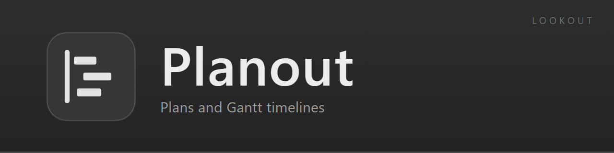

<b>Screen design and prototypes</b> Version 1.0.2 for Windows · Free · Offline · No account

<a href="https://github.com/plawanpawin-byte/frameout/releases/latest"><b>Download Frameout</b></a> · <a href="https://github.com/plawanpawin-byte/Lookout">All Lookout apps</a>

---

Frameout is a canvas for designing app screens and web pages. Draw a frame for each screen, fill it with rectangles, circles, lines and text, rearrange layers, then export a screen as an image or an SVG. Link a shape to another frame and click through your design in Preview.

**Made for:** Designers, developers and founders who need a quick, private place to sketch interfaces.

**On this page:** [Screenshots](#see-it-in-action) · [Interface](#the-interface) · [Features](#everything-it-can-do) · [How to use it](#how-to-use-it) · [Shortcuts](#keyboard-shortcuts) · [Formats](#files-and-formats) · [Privacy](#private-by-design) · [Install](#install) · [Questions](#questions)

## What is new in 1.0.2

A refreshed interface: every toolbar button now has a clear line icon, the app's mark sits at the top left, controls share one height and spacing, panels line up in tidy grids, and the toolbar keeps every button reachable on smaller windows by switching less important buttons to icons.

## See it in action

### Two screens on the canvas

Frames for a home screen and a detail screen, built from rectangles, circles and text. The layers list on the left names every object.

### Layer properties

Select a layer to change its position, size, corner radius, fill, outline, opacity and text.

### Selecting several layers

Shift + click to select more than one layer and move or style them together.

### Exported home screen

Select a frame and export it as a crisp PNG.

### Exported detail screen

Each frame exports on its own, so one file can hold a whole app.

## The interface

- **Top bar:** file buttons, the drawing tools (Move, Frame, Rectangle, Ellipse, Line, Text), undo, redo, duplicate, delete, zoom, Preview and Export PNG / SVG.
- **Left panel:** every layer by name, with show/hide and lock buttons.
- **Right panel:** position, size, name, fill, stroke, corner radius, opacity, prototype link and arrange controls of the selection.

## Everything it can do

### Drawing

- Frame, rectangle, ellipse, line and text tools
- Corner radius, fill, outline width and opacity
- Font size for text

### Layers

- A layer list with names, with hide and lock for each layer
- Frames hold the objects placed inside them

### Prototype

- Give a shape a link to a frame
- Preview mode lets you click through your screens like a real app

### Canvas

- Infinite canvas with pan, zoom and Fit
- Duplicate, delete, undo and redo

### Files and export

- Save and reopen .frameout files
- Export the selected frame as PNG
- Export SVG for developers

## How to use it

1. Pick **Frame** and drag out a screen.
2. Choose **Rectangle**, **Ellipse**, **Line** or **Text** and draw inside it.
3. Select a layer to change its colours and size on the right.
4. Give a button a link to another frame, then press **Preview**.
5. Select a frame and press **Export PNG** or **Export SVG**.

## Keyboard shortcuts

| Keys | What it does |
| --- | --- |
| V / F / R / O / L / T | Move, Frame, Rectangle, Ellipse, Line, Text |
| Shift + click | Select several |
| Space + drag, or scroll | Pan |
| Ctrl + mouse wheel | Zoom |
| Ctrl + A / C / V / D | Select all, copy, paste, duplicate |
| Ctrl + S / O | Save / open |
| Ctrl + Z / Y | Undo / redo |

## Files and formats

Saves .frameout files. Exports PNG and SVG.

## Private by design

- No account, no sign-in, no subscription, no ads.
- Frameout works offline. It never sends your files, your text or anything about how you use it anywhere.
- Files are opened and saved only through the Windows file dialogs you use. Frameout cannot browse your disk on its own.
- The app window runs in a locked-down sandbox with a strict content policy.

## Install

1. Open the [latest release](https://github.com/plawanpawin-byte/frameout/releases/latest) and download the file named **Frameout-Setup-** followed by the version number and **.exe**. You can also install it from the [Lookout launcher](https://github.com/${OWNER}/lookout-launcher), which keeps it up to date.
2. Run the installer. It installs just for you, so it does not ask for administrator rights.
3. Windows may show a blue **Windows protected your PC** screen because these installers are not signed with a paid certificate. Click **More info**, then **Run anyway**.
4. Open Frameout from the Start menu.

**Requirements:** Windows 10 or 11, 64-bit. About 500 MB of free disk space. No internet connection is needed to use the app.

## Questions

**Can I import from Figma?**  
No. Frameout is a standalone sketching tool.

**Does Preview need internet?**  
No. Everything runs offline.

## About Lookout

Frameout belongs to the **[Lookout](https://github.com/plawanpawin-byte/Lookout)** family: ten small, private Windows apps for documents and media, all with the same calm grey look and the same promise that your files stay yours. Install and update them together with the [Lookout launcher](https://github.com/plawanpawin-byte/lookout-launcher).

- **[Pageout](https://github.com/plawanpawin-byte/pageout)**: read, annotate and sign pdfs
- **[Chartout](https://github.com/plawanpawin-byte/chartout)**: flowcharts and diagrams
- **[Branchout](https://github.com/plawanpawin-byte/branchout)**: mind maps and outlines
- **[Planout](https://github.com/plawanpawin-byte/planout)**: plans and gantt timelines
- **[Cutout](https://github.com/plawanpawin-byte/cutout)**: video editing on a timeline
- **[Shiftout](https://github.com/plawanpawin-byte/shiftout)**: convert and compress media
- **[Castout](https://github.com/plawanpawin-byte/castout)**: record your screen
- **[Mendout](https://github.com/plawanpawin-byte/mendout)**: repair damaged media
- **[Tuneout](https://github.com/plawanpawin-byte/tuneout)**: record and edit audio

Released under the MIT License.
